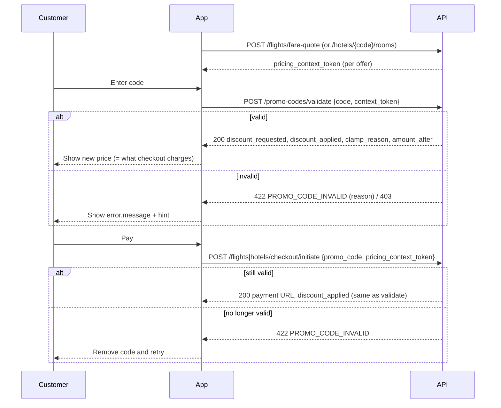

# Promotions — Frontend Reference

> Audience: web / mobile / admin-dashboard developers.
> Base URL: `{{baseUrl}}/api/v1` · Auth: `Authorization: Bearer <token>` · Headers: `Accept: application/json`, `Accept-Language: ar|en`
> Last verified against code: 2026-10-09 (Phase 1 — Promotions)
> Breaking changes: `docs/global/22-frontend-breaking-changes.md` rows 23–27

Promotions are **promo codes only**. There are no automatic discounts, no public offers list, no offer gallery and no "new offer" push. The customer types a code, the app previews it with `POST /promo-codes/validate`, and checkout re-checks it. A code is either applied or the checkout fails with 422 — it is never silently dropped.

Messages come in the request language (`Accept-Language`, default Arabic) in `message`, with `message_en` always in English for logging.

<!-- BEGIN: e2e-supplement -->
## 0. Overview & verified behaviour (E2E 2026-10-08)

**Overview.** Admins create promo codes (`/admin/promo-codes`), customers preview a code with `POST /promo-codes/validate`, and the code is applied for real by sending `promo_code` on flight/hotel checkout. Usage is `reserved` at checkout, `applied` on payment, and released on payment failure.

**Re-verified live 2026-10-08 (context-token flow, EGP, TBO stage + MyFatoorah test mode).** How the discount relates to the price, margin and tax is in [`Pricing/frontend-reference.md` §6–§9](../Pricing/frontend-reference.md#6-promo-code-impact).

| Step | Result | Booking |
|---|---|---|
| Flight `QAPCT10` (10 %) validate with token | requested 1,954.59 → applied 294.27, `min_margin`, after 19,251.65 | — |
| Same code at checkout | identical numbers, `discount_changed: false`; DB `locked_sell_price` 19,251.65; usage `reserved` → `applied` on payment | `FLT-1791484359-4645` |
| Flight `SAVE50` → payment failed | usage `released`, `used_count` 1 → 0 | `FLT-1791484488-4587` |
| Flight `QACAP100` → paid → fulfillment failed | usage `cancelled`, `used_count` 1 → 0 | `FLT-1791484589-2411` |
| Hotel `QAFIX25` with RSR (injected; TBO stage sends none) | 25 → 19.47 `rsr`; checkout identical | `SAFER-1791484909-3176` |
| Hotel `SAVE50` / `QAPCT10` with RSR | → 19.47 `combined` | — |
| Hotel `SAVE50` → payment failed | usage `released` | `SAFER-1791486000-6042` |
| Validate without token, `QAPCT10` | **1,954.59** (`is_estimate: true`, no clamps) — checkout gives 294.27 | — |

**Edge cases**

| # | Scenario | Behaviour (live) |
|---|---|---|
| 1 | Validate vs checkout | Equal to the cent with the same token (F-PRO-1 fixed). The estimate (no token) ignores every floor |
| 2 | Code currency ≠ booking currency | Converted, not rejected: 50 USD → 2,620.06 EGP (then clamped). `currency_unavailable` only when no rate exists |
| 3 | `max_discount` cap | Applied inside `discount_requested`; `clamp_reason` stays `null` (`QACAP100`: 100 / 100) |
| 4 | Token of another user / expired / unknown / other offer | 403 `PRICING_CONTEXT_FORBIDDEN` / 422 `session_expired` / 422 `session_expired` / 422 `invalid_context` |
| 5 | Code + points | 422 `PROMO_CODE_NOT_COMBINABLE` |
| 6 | Customer refund | Requested / approved: usage stays `applied`. Completed for the full amount: usage `cancelled`, code given back (since `0824762`). Partial refund: stays `applied` |
| 7 | `valid_to` | Stored as `YYYY-MM-DDT00:00:00Z` — a code with `valid_to=2026-12-31` stops at the **start** of that day |
| 8 | Margin impact | The discount comes entirely out of margin: `expected_margin` 1,256.85 → 962.58 after `QAPCT10` |
<!-- END: e2e-supplement -->

## 1. Roles x Permissions Matrix

| Action / Endpoint | Permission | Guest | Customer | super_admin | admin | operations | finance | support | devops |
|---|---|---|---|---|---|---|---|---|---|
| `POST /promo-codes/validate` | signed in | ❌ 401 | ✅ | ✅ | ✅ | ✅ | ✅ | ✅ | ✅ |
| Checkout with `promo_code` | (checkout rules) | per checkout | ✅ | — | — | — | — | — | — |
| `GET /admin/promo-codes`, `/{id}`, `/{id}/usages`, `/stats` | `offers.view` | ❌ | ❌ 403 | ✅ | ✅ | ✅ | ❌ | ❌ | ❌ |
| `POST /admin/promo-codes` | `offers.create` | ❌ | ❌ | ✅ | ✅ | ❌ | ❌ | ❌ | ❌ |
| `PUT /admin/promo-codes/{id}` | `offers.edit` | ❌ | ❌ | ✅ | ✅ | ❌ | ❌ | ❌ | ❌ |
| `POST /admin/promo-codes/preview` (`margin` block needs `pricing.view` too) | `offers.create` or `offers.edit` | ❌ | ❌ | ✅ | ✅ (no `margin`) | ❌ | ❌ | ❌ | ❌ |
| `DELETE /admin/promo-codes/{id}` | `offers.delete` | ❌ | ❌ | ✅ | ✅ | ❌ | ❌ | ❌ | ❌ |
| `POST /admin/promo-codes/{id}/toggle` | `offers.activate` | ❌ | ❌ | ✅ | ✅ | ❌ | ❌ | ❌ | ❌ |
| `GET /admin/promo-codes/{id}/gallery` | `offers.view` | ❌ | ❌ 403 | ✅ | ✅ | ✅ | ❌ | ❌ | ❌ |
| `POST|PUT|DELETE /admin/promo-codes/{id}/gallery…` | `offers.edit` | ❌ | ❌ 403 | ✅ | ✅ | ❌ | ❌ | ❌ | ❌ |
| `GET /admin/offers`, `/admin/offers/{id}` (archived, read-only) | `offers.view` | ❌ | ❌ | ✅ | ✅ | ✅ | ❌ | ❌ | ❌ |

## 2. Endpoints

### 2.1 `POST /promo-codes/validate` — preview a code

| Item | Value |
|---|---|
| Auth | Bearer (any signed-in user) |
| Throttle | 20 requests / minute |

The endpoint has two modes:

| Mode | Send | Result |
|---|---|---|
| **Exact** (use this) | `code` + `context_token` | The discount checkout will apply, after every server-side limit. `is_estimate: false` |
| Estimate (legacy) | `code` + `product_type`, `amount`, `currency` (+ trip fields) | The code's own discount only. Checkout can give **less**. `is_estimate: true` |

#### Promo validation flow

1. **Flights:** `POST /flights/fare-quote` returns `pricing_context_token` and `pricing_context_expires_at` at the top level of the response.
   **Hotels:** `POST /hotels/{hotelCode}/rooms` returns `rooms[].pricing_context_token`, one per rate, plus `pricing_context_ttl_minutes`.
2. When the customer applies a code: `POST /promo-codes/validate { code, context_token }`.
3. At payment: send the same token as `pricing_context_token` on `POST /flights|hotels/checkout/initiate` together with `promo_code`. Checkout charges the discount validate showed.

The token is opaque. It points to a server-side snapshot of the offer (price, supplier cost, supplier minimum price, margin rule) that never leaves the server.

**Request (exact)**

```json
{
  "code": "SAVE50",
  "context_token": "c1c7cd1b-8ff3-4c6d-bfbd-f997ed92a57a"
}
```

**Response — 200 (exact, discount reduced by the margin floor)**

```json
{
  "success": true,
  "data": {
    "valid": true,
    "code": "SAVE50",
    "discount_type": "percentage",
    "discount_value": 50,
    "discount_requested": 600,
    "discount_applied": 42.11,
    "discount_amount": 42.11,
    "clamp_reason": "min_margin",
    "clamp_message": "The discount was reduced to the maximum available for this booking.",
    "amount_before": 1200,
    "amount_after": 1157.89,
    "original_amount": 1200,
    "final_amount": 1157.89,
    "currency": "SAR",
    "is_estimate": false,
    "expires_at": "2026-10-08T18:56:37+00:00",
    "message": "تم تطبيق الرمز SAVE50. ستوفر 42.11 SAR.",
    "message_en": "Code SAVE50 applied. You save 42.11 SAR."
  }
}
```

`discount_amount`, `original_amount` and `final_amount` are kept for older clients and equal `discount_applied`, `amount_before` and `amount_after`.

**Request (estimate, legacy)**

```json
{
  "code": "SAVE10",
  "product_type": "flight",
  "origin": "RUH",
  "destination": "DXB",
  "airline_code": "SV",
  "amount": 1000,
  "currency": "SAR"
}
```

Hotels: send `product_type: "hotel"`, `destination` (city code) and optionally `destination_country` (2 letters); leave out `origin` / `airline_code`. The response has the same fields with `is_estimate: true`, `clamp_reason: null`, `expires_at: null`.

#### Clamp reasons (`data.clamp_reason`)

| Value | Meaning | Suggested UI |
|---|---|---|
| `null` | The full discount applies (a `max_discount` cap is already inside `discount_requested`, so it is not a clamp) | "You save X" |
| `min_margin` | Reduced so the booking keeps its minimum margin | "You save X (maximum available for this booking)" |
| `rsr` | Reduced to the supplier's minimum selling price (hotels) | Same as above |
| `combined` | Both limits reduced it | Same as above |
| `currency_mismatch` | No exchange rate for the code's currency | Not returned on 200; validate answers 422 `currency_unavailable` |
| `no_discount_applicable` | Nothing is left after the limits | Not returned on 200; validate answers 422 `no_discount_applicable` |

Use `clamp_message` as the label; never compute or show why in numbers. The backend does not send costs, margins or the supplier minimum.

#### UI guidance — requested vs applied

- When `discount_applied < discount_requested`, show the applied amount as the saving, optionally with the struck-through code value: "SAVE50: ~~600.00~~ 42.11 SAR off".
- Show `amount_after` as the price to pay. It is exactly the amount checkout charges for the same token.
- Re-validate when the customer changes the selected flight or room: each offer has its own token.

#### Token expiry handling

- The token lives `30` minutes (`PRICING_CONTEXT_TTL_MINUTES`). Every validate or checkout that reads it restarts the 30 minutes (`expires_at` in the response).
- Expired or unknown token → 422 `session_expired`. Request a new fare quote / room list (new token), then validate again.
- Token issued to another account → 403 `PRICING_CONTEXT_FORBIDDEN`. A token issued while signed out is claimed by the first signed-in user who uses it.
- Checkout with a token for a different offer (other flight `reference_index`, other hotel / rate / dates) → 422 `invalid_context`.

**Response — 422 (code cannot be used)**

```json
{
  "success": false,
  "message": "انتهت صلاحية رمز الخصم.",
  "error": {
    "code": "PROMO_CODE_INVALID",
    "message": "انتهت صلاحية رمز الخصم.",
    "message_en": "This promo code has expired.",
    "hint": "تحقق من الرمز، أو أكمل الحجز بدونه.",
    "details": { "field": "promo_code", "reason": "expired" }
  }
}
```

**Errors**

| HTTP | Code | Meaning | UI handling |
|---|---|---|---|
| 401 | `UNAUTHENTICATED` | Not signed in | Ask the user to sign in before applying a code |
| 403 | `PRICING_CONTEXT_FORBIDDEN` | `context_token` belongs to another account | Get a new fare quote / room list |
| 422 | `PROMO_CODE_INVALID` | Code cannot be used (see reasons in §3) | Show `error.message` under the code field; keep the original price |
| 422 | `PROMO_CODE_INVALID` reason `session_expired` | Token expired | Refresh the quote, then re-apply the code |
| 422 | validation | Missing/invalid fields | Show field errors from `error.details` |
| 429 | rate limit | More than 20 tries per minute | Disable the Apply button until `Retry-After` |

**UI States**

| State | Trigger | Expected UI |
|---|---|---|
| Loading | Request in flight | Spinner on the Apply button |
| Success | 200 | Show `data.message`, strike through the original price, show `amount_after`; if `clamp_reason` is set show `clamp_message` |
| Error | 422 | Show `error.message` + `error.hint`; offer "Remove code" |

With `context_token` the preview equals checkout. Without it (estimate) checkout can give a **lower** discount — always send the token.

### 2.2 Checkout with a code

`POST /flights/checkout/initiate` and `POST /hotels/checkout/initiate` accept `promo_code` and `pricing_context_token` (the token used on validate). Checkout runs the same calculation as validate and answers:

```json
{
  "success": true,
  "booking_reference": "FLT-1791484033-8971",
  "payment_url": "https://…",
  "amount_before": 1200,
  "amount_after": 1157.89,
  "discount_requested": 600,
  "discount_applied": 42.11,
  "clamp_reason": "min_margin",
  "discount_changed": false,
  "currency": "SAR"
}
```

`discount_changed: true` means the offer price moved since validate (for example a new fare quote or a PreBook price change). The discount was recalculated on the new price; show the new `amount_after` before redirecting to payment.

| Case | Result |
|---|---|
| Valid code | Discount applied; code reserved for this booking |
| Token expired / other account / other offer | 422 `session_expired` / 403 `PRICING_CONTEXT_FORBIDDEN` / 422 `invalid_context` |
| Code cannot be used (any reason, including promotions turned off) | 422 `PROMO_CODE_INVALID` with `error.details.reason` (was: silently ignored or 500) |
| `promo_code` **and** `points_to_redeem` > 0 | 422 `PROMO_CODE_NOT_COMBINABLE` — use one or the other |
| No code | No automatic discount |

On 422, keep the user on the checkout page, show `error.message`, and let them remove the code and retry.

### 2.3 Admin — `GET /admin/promo-codes`

Query: `search` (code/name), `status` (`active` · `inactive` · `scheduled` · `expired` · `exhausted`), `product_type` (`flight` · `hotel` · `both`), `per_page` (1–100, default 20).

**Response — 200** (paginated)

```json
{
  "success": true,
  "data": [
    {
      "id": 1,
      "code": "SAVE10",
      "name": "Save 10%",
      "description": null,
      "discount_type": "percentage",
      "discount_value": 10,
      "max_discount": 200,
      "currency": "SAR",
      "min_booking_amount": 500,
      "max_booking_amount": null,
      "product_type": "both",
      "origin": null,
      "destination": null,
      "airline_code": null,
      "valid_from": "2026-10-09T00:00:00+00:00",
      "valid_to": "2026-12-31T23:59:59+00:00",
      "usage_limit_total": 1000,
      "usage_limit_per_customer": 1,
      "used_count": 12,
      "is_active": true,
      "is_public": false,
      "status": "active",
      "created_by": 3,
      "created_at": "2026-10-09T08:00:00+00:00",
      "updated_at": "2026-10-09T08:00:00+00:00"
    }
  ],
  "meta": { "current_page": 1, "last_page": 1, "per_page": 20, "total": 1, "from": 1, "to": 1 },
  "links": { "first": "…?page=1", "last": "…?page=1", "prev": null, "next": null }
}
```

`status` is computed for display, in this priority: `inactive` → `scheduled` → `expired` → `exhausted` → `active`.

### 2.4 Admin — `POST /admin/promo-codes` (201) / `PUT /admin/promo-codes/{id}` (200, partial)

```json
{
  "code": "RUHDXB50",
  "name": "Riyadh → Dubai 50 SAR",
  "description": "Autumn campaign",
  "discount_type": "fixed",
  "discount_value": 50,
  "currency": "SAR",
  "min_booking_amount": 300,
  "product_type": "flight",
  "origin": "RUH",
  "destination": "DXB",
  "airline_code": "SV",
  "valid_from": "2026-10-10",
  "valid_to": "2026-11-30",
  "usage_limit_total": 500,
  "usage_limit_per_customer": 1,
  "is_active": true
}
```

Response: the promo code (same shape as §2.3) and `message` ("تم إنشاء رمز الخصم." / "Promo code created."). `PUT` accepts any subset of fields.

### 2.5 Admin — other endpoints

| Endpoint | Response | Message |
|---|---|---|
| `GET /admin/promo-codes/{id}` | promo code | — |
| `DELETE /admin/promo-codes/{id}` | `message` only (soft delete; history kept) | تم حذف رمز الخصم. / Promo code deleted. |
| `POST /admin/promo-codes/{id}/toggle` | promo code with flipped `is_active` | تم تفعيل رمز الخصم. / تم إيقاف رمز الخصم. |
| `GET /admin/promo-codes/{id}/usages?status=&per_page=` | paginated rows: `id`, `booking_reference`, `product_type`, `status`, `currency`, `discount_amount`, `original_amount`, `final_amount`, `customer {id,name,email}`, `created_at`, `updated_at` | — |
| `GET /admin/promo-codes/stats` | see below | — |
| `GET /admin/promo-codes/{id}/gallery` | ordered list of gallery images | — |
| `POST /admin/promo-codes/{id}/gallery` (multipart) | created image | تمت إضافة الصورة. / Image added. |
| `PUT /admin/promo-codes/{id}/gallery/{imageId}` | updated image | تم تحديث الصورة. / Image updated. |
| `PUT /admin/promo-codes/{id}/gallery/{imageId}/primary` | image with `is_primary: true` | تم تعيين الصورة الرئيسية. / Primary image set. |
| `POST /admin/promo-codes/{id}/gallery/reorder` | `message` only | تم حفظ ترتيب الصور. / Gallery order saved. |
| `DELETE /admin/promo-codes/{id}/gallery/{imageId}` | `message` only | تم حذف الصورة. / Image removed. |

#### Promo code gallery

A promo code can carry a gallery of images (`promo_codes` were the only promotions entity without one). Permissions: `offers.view` to read, `offers.edit` to change. Uploads go to the `public` disk at `promo-codes/{id}/gallery`; `GET /storage/...` or `image_url` serves them.

- `POST …/gallery` is **multipart/form-data**: `image` (jpg/jpeg/png/webp/gif ≤ 5 MB), `alt_text?`, `is_primary?`, `sort_order?`. The first image of a code is always primary. If `is_primary=true`, the previous primary is demoted.
- `PUT …/gallery/{imageId}` edits `alt_text` and/or `sort_order` (metadata only — the binary is immutable).
- `PUT …/gallery/{imageId}/primary` makes that image the single primary.
- `POST …/gallery/reorder` sends `{ "images": [id, id, …] }` — a complete ordered list of the code's image ids. An id from another code is rejected (422 `images`).
- `DELETE …/gallery/{imageId}` removes the row and the stored file; if the deleted image was primary, the next image (by order) is promoted.
- `GET /admin/promo-codes/{id}` includes `images` when the relation is loaded (the show endpoint eager-loads it).

Image object: `id`, `promo_code_id`, `image_url`, `image_path`, `alt_text`, `is_primary`, `sort_order`, `created_at`, `updated_at`.

```json
{
  "success": true,
  "message": "Image added.",
  "data": {
    "id": 7, "promo_code_id": 3, "image_url": "http://localhost/storage/promo-codes/3/gallery/abc.jpg",
    "image_path": "promo-codes/3/gallery/abc.jpg", "alt_text": "Summer 2026",
    "is_primary": true, "sort_order": 1,
    "created_at": "2026-10-12T09:00:00+03:00", "updated_at": "2026-10-12T09:00:00+03:00"
  }
}
```

**Stats — 200**

```json
{
  "success": true,
  "data": {
    "codes": { "total": 12, "active": 7, "inactive": 3, "scheduled": 1, "expired": 1 },
    "usages": { "reserved": 2, "applied": 40, "released": 5, "cancelled": 1 },
    "by_currency": [
      { "currency": "SAR", "uses": 38, "discount_total": 3420.5, "revenue_total": 81230 },
      { "currency": "USD", "uses": 2, "discount_total": 40, "revenue_total": 910 }
    ],
    "top_codes": [ { "id": 1, "code": "SAVE10", "name": "Save 10%", "uses": 30 } ]
  }
}
```

Money totals count `applied` (paid) usages only and are never summed across currencies.

### 2.6 Admin — `POST /admin/promo-codes/preview` (discount preview)

Permission: `offers.create` or `offers.edit`. Shows what a code would really grant, computed by the same function checkout uses. Nothing is saved, reserved or counted. Use it on the create/edit screen before saving or activating.

The configured percentage is **not** a guaranteed discount: checkout lowers it so the price stays above the minimum margin over supplier cost and above the supplier's minimum selling price (RSR). The preview shows by how much on a given price.

**Two modes**

| Mode | Send | Accuracy | Label in the UI |
|---|---|---|---|
| `context` | `context_token` = the `pricing_context_token` of a fare quote / hotel rooms call **made by the same admin** | Exact for that offer | "Preview on a real offer" |
| `sample` | `sample { amount, supplier_cost, currency, rsr? }` typed by the admin | Illustrative (`is_illustrative: true`) | "Illustrative example" + `hints[illustrative]` |

Discount fields: send `discount_type`, `discount_value`, `max_discount`, `currency` from the form (draft). For an existing code also send `promo_code_id`; form fields override the saved values.

```json
{
  "discount_type": "percentage",
  "discount_value": 20,
  "currency": "USD",
  "sample": { "amount": 19956.97, "supplier_cost": 18885.92, "currency": "EGP" }
}
```

**Response — 200**

```json
{
  "success": true,
  "data": {
    "mode": "sample",
    "is_illustrative": true,
    "discount_type": "percentage",
    "discount_value": 20,
    "max_discount": null,
    "code_currency": "USD",
    "currency": "EGP",
    "exchange_rate": 52.36,
    "amount_before": 19956.97,
    "discount_requested": 3991.39,
    "discount_max_available": 77.05,
    "discount_applied": 77.05,
    "amount_after": 19879.92,
    "clamp_reason": "min_margin",
    "clamp_message": "The discount was reduced to the maximum available for this booking.",
    "hints": [
      { "key": "margin_hint", "message": "The final discount may be lower than the configured discount, depending on the available margin for the booking or the supplier's minimum selling price." },
      { "key": "illustrative", "message": "Illustrative example only: the actual discount is calculated for each booking." }
    ]
  }
}
```

| Field | Show as |
|---|---|
| `discount_requested` | "Configured discount" (20 % of the price, capped by `max_discount`) |
| `discount_max_available` | "Maximum discount this price allows". `null` in `context` mode unless the user has `pricing.view` |
| `discount_applied` / `amount_after` | "Customer gets" / "Customer pays" |
| `clamp_reason` / `clamp_message` | Why it is lower (same values as §2.1) |
| `exchange_rate` | Rate used to convert the code currency (`null` when the currencies match). Live rate: it changes daily |
| `hints[]` | Show every message under the preview. `currency_hint` appears for fixed codes or a `max_discount` in another currency |
| `margin` | Only for users with `pricing.view`: `min_margin_percent`, `mode` (`legacy` / `unified`), `margin_floor`, `rsr`, `supplier_cost`. Never show it to other roles |

Errors: 422 validation (`sample` or `context_token` required, not both; `discount_value` ≤ 100 for percentage); 422 `session_expired` for an expired token; 403 `PRICING_CONTEXT_FORBIDDEN` for a token issued to another user.

Do not compute the discount in the frontend, and never show `discount_applied` as a guaranteed value on the code card: it depends on each booking.

**Usage statuses**

| Status | Meaning | Counts against limits |
|---|---|---|
| `reserved` | Checkout started, payment pending | Yes |
| `applied` | Booking paid | Yes |
| `released` | Payment failed or abandoned | No |
| `cancelled` | Fulfillment failed | No |

## 3. Validation Messages

### Promo code reasons (`error.details.reason`)

| Reason | Message (en) | Message (ar) |
|---|---|---|
| `unavailable` | Promotions are currently unavailable. | العروض غير متاحة حالياً. |
| `code_required` | Please enter a valid promo code. | يرجى إدخال رمز خصم صحيح. |
| `not_found` | This promo code doesn't exist. | رمز الخصم غير موجود. |
| `inactive` | This promo code isn't active. | رمز الخصم غير مفعّل. |
| `not_started` | This promo code isn't active yet. | رمز الخصم لم يبدأ بعد. |
| `expired` | This promo code has expired. | انتهت صلاحية رمز الخصم. |
| `not_for_product` | This promo code isn't valid for this type of booking. | رمز الخصم غير صالح لهذا النوع من الحجوزات. |
| `not_for_flight` | This promo code doesn't apply to the selected flight. | رمز الخصم لا ينطبق على الرحلة المختارة. |
| `not_for_hotel` | This promo code doesn't apply to the selected hotel. | رمز الخصم لا ينطبق على الفندق المختار. |
| `currency_unavailable` | This promo code can't be used with :currency right now. | لا يمكن استخدام رمز الخصم مع عملة :currency حالياً. |
| `not_for_price` | This promo code doesn't apply to this amount. | رمز الخصم لا ينطبق على هذا المبلغ. |
| `min_amount` | This promo code needs a booking of at least :amount. | رمز الخصم يتطلب حجزاً بقيمة :amount على الأقل. |
| `max_amount` | This promo code is valid for bookings up to :amount. | رمز الخصم صالح للحجوزات حتى :amount فقط. |
| `usage_limit` | This promo code has reached its usage limit. | تم استخدام رمز الخصم بالحد الأقصى المسموح. |
| `user_limit` | You've already used this code the maximum number of times. | لقد استخدمت هذا الرمز بالحد الأقصى المسموح. |
| `not_available` | This promo code isn't available to you. | رمز الخصم غير متاح لك. |
| `reserve_failed` | We couldn't reserve this promo code. Please try again. | تعذّر حجز رمز الخصم. حاول مرة أخرى. |
| `apply_failed` | We couldn't apply this promo code to your order. | تعذّر تطبيق رمز الخصم على هذا الطلب. |
| `not_combinable` (code `PROMO_CODE_NOT_COMBINABLE`) | You can use a promo code or points on a booking, not both. | يمكنك استخدام رمز خصم أو نقاط في الحجز الواحد، وليس الاثنين معاً. |

`:amount` is formatted like `1,500.00 SAR` (converted to the booking currency).

### Context reasons (validate with `context_token`, checkout with `pricing_context_token`)

These replace the legacy reasons above when a token is sent. `error.message_key` is `promo.<reason>` (`lang/{ar,en}/promo.php`).

| Reason | Replaces | Message (en) | Message (ar) |
|---|---|---|---|
| `code_invalid` | `code_required`, `not_found`, `inactive`, `not_started` | This promo code isn't valid. | رمز الخصم غير صالح. |
| `code_expired` | `expired` | This promo code has expired. | انتهت صلاحية رمز الخصم. |
| `session_expired` | — | Your price quote has expired. Please check the price again, then re-apply the code. | انتهت صلاحية عرض السعر. يُرجى مراجعة السعر مرة أخرى ثم إعادة تطبيق الرمز. |
| `invalid_context` | — (also 403 `PRICING_CONTEXT_FORBIDDEN`) | This price quote doesn't match your booking. Please check the price again. | عرض السعر لا يطابق حجزك. يُرجى مراجعة السعر مرة أخرى. |
| `limit_reached` | `usage_limit`, `user_limit` | This promo code has reached its usage limit. | تم استخدام رمز الخصم بالحد الأقصى المسموح. |
| `wrong_product` | `not_for_product` | This promo code isn't valid for this type of booking. | رمز الخصم غير صالح لهذا النوع من الحجز. |
| `wrong_route` | `not_for_flight` / `not_for_hotel` (origin/destination) | This promo code doesn't apply to this destination. | رمز الخصم لا ينطبق على هذه الوجهة. |
| `wrong_airline` | `not_for_flight` (airline) | This promo code doesn't apply to this airline. | رمز الخصم لا ينطبق على شركة الطيران هذه. |
| `min_amount` | `min_amount` | This promo code needs a booking of at least :amount :currency. | يتطلب رمز الخصم حجزًا بقيمة :amount :currency على الأقل. |
| `max_amount` | `max_amount` | This promo code is valid for bookings up to :amount :currency. | رمز الخصم صالح للحجوزات حتى :amount :currency. |
| `no_discount_applicable` | `not_for_price` | This promo code can't lower the price of this booking any further. | لا يمكن لرمز الخصم تخفيض سعر هذا الحجز أكثر من ذلك. |

`unavailable`, `not_available`, `currency_unavailable` keep their legacy reason and message in both modes.

### Admin form

| Field | Rule | UI hint |
|---|---|---|
| `code` | 3–50 chars, `A–Z 0–9 _ -`, unique | Uppercase automatically |
| `discount_value` | > 0; ≤ 100 when `percentage` | |
| `max_booking_amount` | ≥ `min_booking_amount` | |
| `valid_to` | ≥ `valid_from` | |
| `origin`, `airline_code` | not allowed when `product_type` = `hotel` | Hide these fields for hotel codes |
| `currency` | one of the supported currencies | Dropdown. Percentages ignore it; fixed values, `max_discount` and min/max booking amounts are converted to the booking currency at the live rate |
| `discount_value` + `discount_type` | — | Always show the margin hint next to it (below) |
| `max_discount` | nullable, > 0 | Label "أقصى خصم (بعملة الكود)" / "Maximum discount (in the code currency)". It is the admin's own cap, not the margin limit |

Field names in Arabic errors come from `lang/ar/attributes.php` (e.g. نوع الخصم، قيمة الخصم).

**Margin hint** (`promo.admin.margin_hint`, also returned in the preview `hints`):

- AR: الخصم النهائي قد يكون أقل من النسبة المحددة حسب هامش الربح المتاح للحجز أو الحد الأدنى لسعر البيع الذي يحدده المورد.
- EN: The final discount may be lower than the configured discount, depending on the available margin for the booking or the supplier's minimum selling price.

Add a "Preview discount" button that calls §2.6 with the current form values.

## 4. Edge Cases

| # | Scenario | Expected behavior |
|---|---|---|
| 1 | Same booking re-submits checkout with the same code | Accepted; the existing reservation is reused (no double count) |
| 2 | Code valid at preview, expires before checkout | Checkout 422 `PROMO_CODE_INVALID` reason `code_expired` (`expired` without a token) |
| 3 | Payment fails | Reservation released; the customer can use the code again |
| 4 | Fulfillment fails after payment | Usage `cancelled`; limit slot returned |
| 4a | Customer cancels / refund approved | Usage stays `applied` until the refund is completed (refund amount = post-discount price) |
| 4b | Refund completed for the full amount | Usage `cancelled`; the code is given back. A partial refund keeps it used |
| 5 | Booking total in another currency than the code | Fixed amount, cap and min/max are converted; if no rate exists → `currency_unavailable` |
| 6 | Discount would push the price below the margin floor or the supplier minimum (RSR) | Discount reduced to the floor (`clamp_reason`); if nothing is left → `no_discount_applicable`, in validate **and** checkout |
| 6a | Token expires between validate and checkout | Checkout 422 `session_expired`; nothing is booked or charged |
| 6b | Limit reached by someone else between validate and checkout | Checkout 422 `limit_reached` |
| 6c | Validate called twice, then checkout | Validate never reserves; both previews and checkout return the same discount |
| 6d | Offer price changed between validate and checkout | Checkout recalculates on the new price and returns `discount_changed: true` |
| 7 | Promotions turned off (`OFFERS_ENABLED=false`) | Any code → 422 reason `unavailable` |
| 8 | Old `GET /offers/available` | 404 — remove the offers screen |

## 5. Flow Diagrams



<!-- BEGIN: generated-endpoint-reference (do not edit by hand; regenerate from routes) -->
## Appendix A — Endpoint reference (generated from the live route table, 2026-10-08)

Generated from `php artisan route:list`, the FormRequest / inline `validate()` rules, and live responses captured during the 2026-10-08 E2E run against `http://localhost:8000` (TBO + MyFatoorah sandboxes). Long tokens and supplier booking codes are replaced with `<placeholders>`; lists are cut to one item.

### A.1 Request headers

| Header | Value | When |
|---|---|---|
| `Accept` | `application/json` | Always (otherwise 401/404 may render HTML) |
| `Content-Type` | `application/json` (`multipart/form-data` for uploads) | Requests with a body |
| `Accept-Language` | `ar` or `en` (default `en`) | Always — selects the language of `error.message`, `hint` and validation texts |
| `Authorization` | `Bearer <token>` | Every endpoint marked **Bearer** below. Customer tokens come from `POST /api/v1/auth/login`, staff tokens from `POST /api/v1/auth/admin/login` |

### A.2 Error responses (real captures, EN + AR)

Two envelope shapes exist today (tracked in `docs/global/frontend-refs-audit.md`, finding F-ENV-1). Read the message as `typeof body.error === "object" ? body.error.message : body.message`, and the machine code as `body.error.code ?? body.error`.

| Status | Meaning | Shape | `error.code` | UI action |
|---|---|---|---|---|
| 400 | Malformed request (rare; e.g. missing `paymentId` on callbacks) | object or string | `validation_error` | Show message |
| 401 | Missing/expired token | object | `unauthenticated` | Clear token, redirect to login |
| 403 | Authenticated but lacks permission / unverified / suspended | **string** (`error: "forbidden"`) | `forbidden` | Hide the action; show message |
| 404 | Resource not found / not owned | object | `not_found` | Show "not found" state |
| 409 | State conflict (e.g. price changed, reconciliation failed) | object or string | endpoint specific | Show conflict dialog |
| 422 | Validation failed — field errors in `error.details` | object | `validation_error` or a domain code | Show per-field errors |
| 429 | Rate limited — wait `error.details.retry_after` s (also `Retry-After` header) | object | `rate_limited` | Disable button + countdown |
| 500 | Unexpected error — quote `trace_id` to support | object or string | `server_error` / endpoint specific | Generic error + retry |
| 502 | Supplier unavailable (TBO) | object | `SUPPLIER_ERROR` | "Try again shortly" |

<details><summary>401 — English / العربية</summary>

```json
{
    "success": false,
    "error": {
        "code": "unauthenticated",
        "message": "Unauthorized",
        "details": null,
        "hint": "Your session may have expired. Log in and try again.",
        "message_en": "Unauthorized",
        "message_key": "unauthorized",
        "category": "auth",
        "severity": "info",
        "event": "auth.unauthenticated"
    },
    "trace_id": "req_6ac7cf47b54ed2.37324331",
    "status_code": 401,
    "message": "Unauthorized"
}
```

```json
{
    "success": false,
    "error": {
        "code": "unauthenticated",
        "message": "يجب تسجيل الدخول للمتابعة.",
        "details": null,
        "hint": "ربما انتهت جلستك. سجّل الدخول ثم أعد المحاولة.",
        "message_en": "Unauthorized",
        "message_key": "unauthorized",
        "category": "auth",
        "severity": "info",
        "event": "auth.unauthenticated"
    },
    "trace_id": "req_6ac7cf59601b89.61075954",
    "status_code": 401,
    "message": "يجب تسجيل الدخول للمتابعة."
}
```

</details>

<details><summary>403 — English / العربية</summary>

```json
{
    "success": false,
    "error": "forbidden",
    "message": "You do not have the required permission.",
    "hint": "Contact your administrator if you need access.",
    "trace_id": "req_6ac7cf4c1f90d6.29264407"
}
```

```json
{
    "success": false,
    "error": "forbidden",
    "message": "You do not have the required permission.",
    "hint": "تواصل مع مدير النظام إذا كنت تحتاج هذه الصلاحية.",
    "trace_id": "req_6ac7cf5bbb1951.47108855"
}
```

</details>

<details><summary>404 — English / العربية</summary>

```json
{
    "success": false,
    "error": {
        "code": "not_found",
        "message": "No query results for model [App\\Modules\\Fulfillment\\Models\\FulfillmentRequest] 999999",
        "details": null,
        "hint": "Check the link or reference number and try again.",
        "message_en": "No query results for model [App\\Modules\\Fulfillment\\Models\\FulfillmentRequest] 999999",
        "message_key": null,
        "category": "system",
        "severity": "info",
        "event": null
    },
    "trace_id": "req_6ac7cf50392151.17778943",
    "status_code": 404,
    "message": "No query results for model [App\\Modules\\Fulfillment\\Models\\FulfillmentRequest] 999999"
}
```

```json
{
    "success": false,
    "error": {
        "code": "not_found",
        "message": "لم نعثر على العنصر المطلوب.",
        "details": null,
        "hint": "تأكد من الرابط أو الرقم المرجعي ثم حاول مرة أخرى.",
        "message_en": "No query results for model [App\\Modules\\Fulfillment\\Models\\FulfillmentRequest] 999999",
        "message_key": "not_found",
        "category": "system",
        "severity": "info",
        "event": null
    },
    "trace_id": "req_6ac7cf5fb94908.21189880",
    "status_code": 404,
    "message": "لم نعثر على العنصر المطلوب."
}
```

</details>

<details><summary>422 — English / العربية</summary>

```json
{
    "success": false,
    "error": {
        "code": "validation_error",
        "message": "Validation failed",
        "details": {
            "code": [
                "The code field is required."
            ],
            "product_type": [
                "The selected product type is invalid."
            ],
            "amount": [
                "The amount must be greater than 0."
            ],
            "currency": [
                "The currency must be 3 characters."
            ]
        },
        "hint": "Check the highlighted fields and try again.",
        "message_en": "Validation failed",
        "message_key": "validation_failed",
        "category": "system",
        "severity": "info",
        "event": "system.validation_failed"
    },
    "trace_id": "req_6ac7cf53144446.72697614",
    "status_code": 422,
    "message": "Validation failed"
}
```

```json
{
    "success": false,
    "error": {
        "code": "validation_error",
        "message": "بعض البيانات المدخلة غير صحيحة.",
        "details": {
            "code": [
                "حقل الرمز مطلوب."
            ],
            "product_type": [
                "نوع المنتج المحدد غير صالح."
            ],
            "amount": [
                "يجب أن تكون قيمة المبلغ أكبر من 0."
            ],
            "currency": [
                "يجب أن يتكون العملة من 3 حرفًا."
            ]
        },
        "hint": "راجع الحقول المحددة ثم حاول مرة أخرى.",
        "message_en": "Validation failed",
        "message_key": "validation_failed",
        "category": "system",
        "severity": "info",
        "event": "system.validation_failed"
    },
    "trace_id": "req_6ac7cf62d0cfb0.29846213",
    "status_code": 422,
    "message": "بعض البيانات المدخلة غير صحيحة."
}
```

</details>

<details><summary>429 — English / العربية</summary>

```json
{
    "success": false,
    "error": {
        "code": "rate_limited",
        "message": "Too many requests",
        "details": {
            "retry_after": 10
        },
        "hint": "Please wait 10 seconds and try again.",
        "message_en": "Too many requests",
        "message_key": "too_many_requests",
        "category": "security",
        "severity": "low",
        "event": "security.rate_limited"
    },
    "trace_id": "req_6ac7d0220d4025.22792911",
    "status_code": 429,
    "message": "Too many requests"
}
```

```json
{
    "success": false,
    "error": {
        "code": "rate_limited",
        "message": "عدد المحاولات كبير جداً.",
        "details": {
            "retry_after": 8
        },
        "hint": "يرجى الانتظار 8 ثانية ثم المحاولة مرة أخرى.",
        "message_en": "Too many requests",
        "message_key": "too_many_requests",
        "category": "security",
        "severity": "low",
        "event": "security.rate_limited"
    },
    "trace_id": "req_6ac7d024841358.79322812",
    "status_code": 429,
    "message": "عدد المحاولات كبير جداً."
}
```

</details>

<details><summary>500 — English / العربية</summary>

```json
{
    "success": false,
    "error": "payment_callback_failed",
    "message": "Payment callback processing failed.",
    "hint": "Try again. If it keeps happening, contact support and mention code req_6ac7cf55df0856.74465660.",
    "trace_id": "req_6ac7cf55df0856.74465660"
}
```

```json
{
    "success": false,
    "error": "payment_callback_failed",
    "message": "Payment callback processing failed.",
    "hint": "حاول مرة أخرى. إذا تكررت المشكلة، تواصل مع الدعم واذكر الرمز req_6ac7cf658c89a2.75829557.",
    "trace_id": "req_6ac7cf658c89a2.75829557"
}
```

</details>

### A.3 Validation messages used by this module (EN / AR)

Returned inside `error.details.<field>[]`; `:attribute` is replaced by the localized field name from `lang/{en,ar}/attributes.php`.

| Rule | English | العربية |
|---|---|---|
| `string` | The :attribute must be a string. | يجب أن يكون :attribute نصاً. |
| `max` | The :attribute must not be greater than :max characters. | يجب ألا يكون عدد حروف :attribute أكبر من :max. |
| `integer` | The :attribute must be an integer. | يجب أن يكون :attribute عددًا صحيحًا. |
| `min` | The :attribute must be at least :min characters. | يجب أن يكون عدد حروف :attribute على الأقل :min. |
| `required` | The :attribute field is required. | حقل :attribute مطلوب. |
| `in` | The selected :attribute is invalid. | :attribute المحدد غير صالح. |
| `numeric` | The :attribute must be a number. | يجب أن يكون :attribute رقمًا. |
| `gt` | The :attribute must be greater than :value characters. | يجب أن يكون عدد حروف :attribute أكبر من :value. |
| `size` | The :attribute must be :size characters. | يجب أن يتكون :attribute من :size حرفًا. |
| `alpha` | The :attribute must only contain letters. | يجب أن يحتوي :attribute على أحرف فقط. |

### A.4 Rate limits and pagination

Throttled endpoints return 429 with `Retry-After`, `X-RateLimit-Limit` and `X-RateLimit-Remaining` headers (verified live: `POST /promo-codes/validate` → 429 on the 21st call within 60 s). Named limiters: `search` = 30/min/IP, `booking` = 10/min/IP, `api` = 60/min/IP, `login` = 5 per 15 min per email+IP. Per-endpoint limits are listed below.

List endpoints that accept `page` / `per_page` return Laravel pagination (`data[]` plus `meta { current_page, per_page, total, last_page }` and `links`) unless noted. `per_page` max is 100 where validated.

### A.5 Roles × permissions (from the seeded `RoleAndPermissionSeeder`)

| Permission | super_admin | admin | operations | finance | support | devops | sales | sales_manager |
|---|---|---|---|---|---|---|---|---|
| `offers.activate` | ✅ | ✅ | — | — | — | — | — | — |
| `offers.create` | ✅ | ✅ | — | — | — | — | — | — |
| `offers.delete` | ✅ | ✅ | — | — | — | — | — | — |
| `offers.edit` | ✅ | ✅ | — | — | — | — | — | — |
| `offers.view` | ✅ | ✅ | ✅ | — | — | — | — | — |

Customers (no role) can only call public and customer endpoints. A route listing several permissions accepts **any one** of them; routes with several `perm` groups need one from **each** group.

### A.6 Postman

All endpoints below are in the consolidated collection [`docs/postman/Safer-Be-API/Safer-Be-API.postman_collection.json`](../../postman/Safer-Be-API/Safer-Be-API.postman_collection.json) (folders `01-Public`, `02-Customer`, `03-Admin`), with environments `Local` / `Staging` / `Production` in the same folder.

### A.7 Endpoints

#### `GET /api/v1/admin/offers`

- **Auth:** Bearer token
- **Permission:** `offers.view`
- **Rate limit:** 60/min per IP (`api`)
- **Headers:** `Accept: application/json`, `Accept-Language: ar|en`, `Authorization: Bearer <token>`
- **Handler:** `Promotions\Http\Controllers\AdminOfferController@index`
- **Body:** none
- **Success:** `200` with `{ "success": true, ... }` (not captured live in this run).
- **Errors:** 401, 403, 429, 500 — see A.2 for bodies.

#### `GET /api/v1/admin/offers/{id}`

- **Auth:** Bearer token
- **Permission:** `offers.view`
- **Rate limit:** 60/min per IP (`api`)
- **Headers:** `Accept: application/json`, `Accept-Language: ar|en`, `Authorization: Bearer <token>`
- **Handler:** `Promotions\Http\Controllers\AdminOfferController@show`
- **Body:** none
- **Success:** `200` with `{ "success": true, ... }` (not captured live in this run).
- **Errors:** 401, 403, 404, 429, 500 — see A.2 for bodies.

#### `GET /api/v1/admin/promo-codes`

- **Auth:** Bearer token
- **Permission:** `offers.view`
- **Rate limit:** 60/min per IP (`api`)
- **Headers:** `Accept: application/json`, `Accept-Language: ar|en`, `Authorization: Bearer <token>`
- **Handler:** `Promotions\Http\Controllers\AdminPromoCodeController@index`
- **Query parameters** (`inline validate()`):

| Field | Rules |
|---|---|
| `search` | `sometimes\|nullable\|string\|max:100` |
| `status` | `sometimes\|nullable\|Rule::in(active\|inactive\|scheduled\|expired\|exhausted` |
| `product_type` | `sometimes\|nullable\|Rule::in(PromoCode::PRODUCT_TYPES)` |
| `per_page` | `sometimes\|integer\|min:1\|max:100` |

Success response — HTTP 200 (live capture `21-promo-list-admin.json`):

```json
{
    "success": true,
    "data": [],
    "meta": {
        "current_page": 1,
        "last_page": 1,
        "per_page": 20,
        "total": 0,
        "from": null,
        "to": null
    },
    "links": {
        "first": "http://localhost:8000/api/v1/admin/promo-codes?page=1",
        "last": "http://localhost:8000/api/v1/admin/promo-codes?page=1",
        "prev": null,
        "next": null
    }
}
```

- **Errors:** 401, 403, 422, 429, 500 — see A.2 for bodies.

#### `POST /api/v1/admin/promo-codes`

- **Auth:** Bearer token
- **Permission:** `offers.create`
- **Rate limit:** 60/min per IP (`api`)
- **Headers:** `Accept: application/json`, `Accept-Language: ar|en`, `Authorization: Bearer <token>`
- **Handler:** `Promotions\Http\Controllers\AdminPromoCodeController@store`
- **Body:** validated by `PromoCodeRequest (rules() needs runtime context)`.
Success response — HTTP 201 (live capture `23-promo-create-SAVE50.json`):

```json
{
    "success": true,
    "message": "Promo code created.",
    "data": {
        "id": 1,
        "code": "SAVE50",
        "name": "E2E Save 50",
        "description": "E2E QA fixed 50 discount",
        "discount_type": "fixed",
        "discount_value": 50,
        "max_discount": null,
        "currency": "USD",
        "min_booking_amount": null,
        "max_booking_amount": null,
        "product_type": "both",
        "origin": null,
        "destination": null,
        "airline_code": null,
        "valid_from": "2026-10-01T00:00:00+00:00",
        "valid_to": "2026-12-31T00:00:00+00:00",
        "usage_limit_total": 100,
        "usage_limit_per_customer": 5,
        "used_count": 0,
        "is_active": true,
        "is_public": true,
        "status": "active",
        "created_by": 43,
        "created_at": "2026-10-08T16:59:53+00:00",
        "updated_at": "2026-10-08T16:59:53+00:00"
    }
}
```

- **Errors:** 401, 403, 422, 429, 500 — see A.2 for bodies.

#### `GET /api/v1/admin/promo-codes/stats`

- **Auth:** Bearer token
- **Permission:** `offers.view`
- **Rate limit:** 60/min per IP (`api`)
- **Headers:** `Accept: application/json`, `Accept-Language: ar|en`, `Authorization: Bearer <token>`
- **Handler:** `Promotions\Http\Controllers\AdminPromoCodeController@stats`
- **Body:** none
- **Success:** `200` with `{ "success": true, ... }` (not captured live in this run).
- **Errors:** 401, 403, 429, 500 — see A.2 for bodies.

#### `DELETE /api/v1/admin/promo-codes/{id}`

- **Auth:** Bearer token
- **Permission:** `offers.delete`
- **Rate limit:** 60/min per IP (`api`)
- **Headers:** `Accept: application/json`, `Accept-Language: ar|en`, `Authorization: Bearer <token>`
- **Handler:** `Promotions\Http\Controllers\AdminPromoCodeController@destroy`
- **Body:** none
- **Success:** `200/204` with `{ "success": true, ... }` (not captured live in this run).
- **Errors:** 401, 403, 404, 429, 500 — see A.2 for bodies.

#### `GET /api/v1/admin/promo-codes/{id}`

- **Auth:** Bearer token
- **Permission:** `offers.view`
- **Rate limit:** 60/min per IP (`api`)
- **Headers:** `Accept: application/json`, `Accept-Language: ar|en`, `Authorization: Bearer <token>`
- **Handler:** `Promotions\Http\Controllers\AdminPromoCodeController@show`
- **Body:** none
- **Success:** `200` with `{ "success": true, ... }` (not captured live in this run).
- **Errors:** 401, 403, 404, 429, 500 — see A.2 for bodies.

#### `PUT /api/v1/admin/promo-codes/{id}`

- **Auth:** Bearer token
- **Permission:** `offers.edit`
- **Rate limit:** 60/min per IP (`api`)
- **Headers:** `Accept: application/json`, `Accept-Language: ar|en`, `Authorization: Bearer <token>`
- **Handler:** `Promotions\Http\Controllers\AdminPromoCodeController@update`
- **Body:** validated by `PromoCodeRequest (rules() needs runtime context)`.
- **Success:** `200` with `{ "success": true, ... }` (not captured live in this run).
- **Errors:** 401, 403, 404, 422, 429, 500 — see A.2 for bodies.

#### `POST /api/v1/admin/promo-codes/{id}/toggle`

- **Auth:** Bearer token
- **Permission:** `offers.activate`
- **Rate limit:** 60/min per IP (`api`)
- **Headers:** `Accept: application/json`, `Accept-Language: ar|en`, `Authorization: Bearer <token>`
- **Handler:** `Promotions\Http\Controllers\AdminPromoCodeController@toggle`
- **Body:** none
- **Success:** `200/201` with `{ "success": true, ... }` (not captured live in this run).
- **Errors:** 401, 403, 404, 429, 500 — see A.2 for bodies.

#### `GET /api/v1/admin/promo-codes/{id}/usages`

- **Auth:** Bearer token
- **Permission:** `offers.view`
- **Rate limit:** 60/min per IP (`api`)
- **Headers:** `Accept: application/json`, `Accept-Language: ar|en`, `Authorization: Bearer <token>`
- **Handler:** `Promotions\Http\Controllers\AdminPromoCodeController@usages`
- **Query parameters** (`inline validate()`):

| Field | Rules |
|---|---|
| `status` | `sometimes\|nullable\|Rule::in( PromoCodeUsage::STATUS_RESERVED\|PromoCodeUsage::STATUS_APPLIED\|PromoCodeUsage::STATUS_RELEASED\|PromoCodeUsage::STATUS_CANCELLED,` |
| `per_page` | `sometimes\|integer\|min:1\|max:100` |

- **Success:** `200` with `{ "success": true, ... }` (not captured live in this run).
- **Errors:** 401, 403, 404, 422, 429, 500 — see A.2 for bodies.

#### `POST /api/v1/promo-codes/validate`

- **Auth:** Bearer token
- **Rate limit:** 20 per minute
- **Headers:** `Accept: application/json`, `Accept-Language: ar|en`, `Authorization: Bearer <token>`
- **Handler:** `Promotions\Http\Controllers\PromoCodeController@validate`
- **Body** (`ValidatePromoCodeRequest`):

| Field | Rules |
|---|---|
| `code` | `required\|string\|max:50` |
| `product_type` | `required\|string\|in:"flight","hotel"` |
| `amount` | `required\|numeric\|gt:0\|max:99999999` |
| `currency` | `required\|string\|size:3\|alpha` |
| `origin` | `nullable\|string\|max:10` |
| `destination` | `nullable\|string\|max:20` |
| `destination_country` | `nullable\|string\|size:2\|alpha` |
| `airline_code` | `nullable\|string\|max:3` |

Example request body:

```json
{
    "code": "string",
    "product_type": "flight",
    "amount": 100,
    "currency": "USD",
    "origin": "string",
    "destination": "string"
}
```

Success response — HTTP 200 (live capture `24-promo-validate-SAVE50-SAR.json`):

```json
{
    "success": true,
    "data": {
        "valid": true,
        "code": "SAVE50",
        "discount_type": "fixed",
        "discount_value": 50,
        "discount_amount": 187.62,
        "original_amount": 1000,
        "final_amount": 812.38,
        "currency": "SAR",
        "message": "Code SAVE50 applied. You save 187.62 SAR.",
        "message_en": "Code SAVE50 applied. You save 187.62 SAR."
    }
}
```

- **Errors:** 401, 422, 429, 500 — see A.2 for bodies.

<!-- END: generated-endpoint-reference -->
