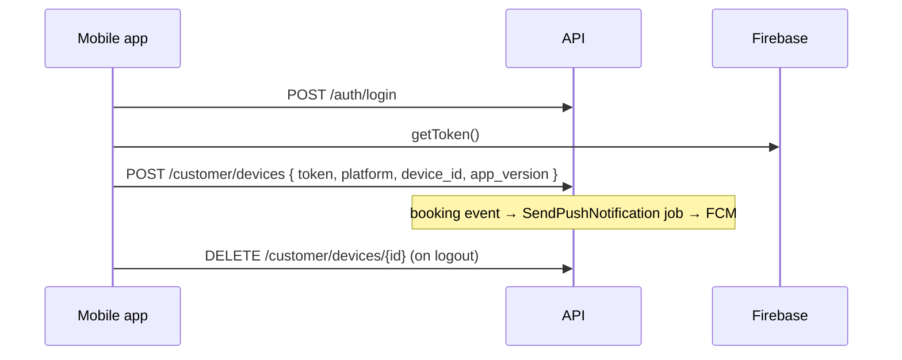

# Notifications — Frontend Reference

> Audience: mobile developers (push) and web/admin developers (email expectations).
> Base URL: `{{baseUrl}}/api/v1` · Auth: `Authorization: Bearer <token>` · Headers: `Accept: application/json`, `Accept-Language: en|ar`
> Last verified against code and a live run: 2026-10-08 (branch `feat/tbo-hotels-json`, commit `7ee33a7`).
> Behaviour details: [`_discovery.md`](_discovery.md) · Template inventory: [`../../global/email-templates-audit.md`](../../global/email-templates-audit.md).

## 0. Overview

The only client-facing API is **push device registration**. Emails and pushes themselves are sent by the backend in reaction to booking events; the frontend never triggers them, but it must know which messages the customer will receive so screens match.

| Area | Endpoints | Who |
|---|---|---|
| List my devices | `GET /customer/devices` | Customer |
| Register / refresh a device token | `POST /customer/devices` | Customer (call after login and whenever FCM/APNs rotates the token) |
| Remove a device (logout) | `DELETE /customer/devices/{device}` | Customer (owner only) |

### Emails the customer receives (verified in the 2026-10-08 E2E run, `jobs` table)

| Moment | Mailable | Verified |
|---|---|---|
| Payment confirmed | `PaymentReceivedMailable` | ✅ queued for `FLT-1791479096-3559` |
| Booking request accepted (assisted fulfillment) | `BookingRequestConfirmedMailable` | ✅ queued |
| Sales completed the booking (PNR / HCN) | `FulfillmentCompletedMailable` — includes PNR, itinerary and download link | ✅ queued; **ticket number missing** (finding F-FUL-2) |
| Refund approved | `RefundApprovedMailable` | ✅ queued |
| Refund paid out | `RefundProcessedMailable` | ✅ queued |
| Refund rejected | `FulfillmentNoticeMail` (`customer.refund_rejected`, sent by Fulfillment) | code path verified |
| `BookingConfirmedMailable` | **Not sent** (retired with assisted fulfillment) | ✅ absent |

Staff also get `FulfillmentNoticeMail` (new case in the Sales queue).

## 1. Roles × Permissions

Device endpoints need only a Bearer token (no permission). A user can only see and delete **their own** devices; another user's device id returns 404.

## 2. UI states

| Screen / action | Loading | Empty | Success | Error |
|---|---|---|---|---|
| Register token (silent, app start / login) | — | — | 200/201, keep the returned `id` locally | 422 → log, retry on next launch; 401 → skip until login |
| Settings → "My devices" | List skeleton | "No devices registered" | List: platform, app version, last used | 401 → login |
| Logout | — | — | Call `DELETE /customer/devices/{id}` **before** `POST /auth/logout` | Ignore 404 |

## 3. Edge cases

| # | Scenario | Expected behaviour |
|---|---|---|
| 1 | Same token posted twice | Upsert — no duplicate row (`token` is unique) |
| 2 | Token moves to another account (shared phone) | Re-registering under the new user re-assigns it |
| 3 | Invalid / expired FCM token | Backend removes it after a failed push; the app simply registers again on next launch |
| 4 | Push consent off (`push_notification_consent=false`, Auth profile) | Booking pushes are not sent; register the token anyway so consent can be re-enabled |
| 5 | `platform` other than `android` / `ios` | 422 |
| 6 | Locale of emails | Emails use the customer's `preferred_locale` (Auth profile), not the request header |

## 4. Validation (module specific)

| Field | Rule | Message (en) | الرسالة (ar) |
|---|---|---|---|
| `token` | required, 8–512 chars | The token field is required. | حقل الرمز مطلوب. |
| `platform` | required, `android` \| `ios` | The selected platform is invalid. | نظام التشغيل المحدد غير صالح. |
| `device_id` | optional, ≤ 191 | — | — |
| `app_version` | optional, ≤ 32 | — | — |

## 5. Flow



<!-- BEGIN: generated-endpoint-reference (do not edit by hand; regenerate from routes) -->
## Appendix A — Endpoint reference (generated from the live route table, 2026-10-08)

Generated from `php artisan route:list`, the FormRequest / inline `validate()` rules, and live responses captured during the 2026-10-08 E2E run against `http://localhost:8000` (TBO + MyFatoorah sandboxes). Long tokens and supplier booking codes are replaced with `<placeholders>`; lists are cut to one item.

### A.1 Request headers

| Header | Value | When |
|---|---|---|
| `Accept` | `application/json` | Always (otherwise 401/404 may render HTML) |
| `Content-Type` | `application/json` (`multipart/form-data` for uploads) | Requests with a body |
| `Accept-Language` | `ar` or `en` (default `en`) | Always — selects the language of `error.message`, `hint` and validation texts |
| `Authorization` | `Bearer <token>` | Every endpoint marked **Bearer** below. Customer tokens come from `POST /api/v1/auth/login`, staff tokens from `POST /api/v1/auth/admin/login` |

### A.2 Error responses (real captures, EN + AR)

Two envelope shapes exist today (tracked in `docs/global/frontend-refs-audit.md`, finding F-ENV-1). Read the message as `typeof body.error === "object" ? body.error.message : body.message`, and the machine code as `body.error.code ?? body.error`.

| Status | Meaning | Shape | `error.code` | UI action |
|---|---|---|---|---|
| 400 | Malformed request (rare; e.g. missing `paymentId` on callbacks) | object or string | `validation_error` | Show message |
| 401 | Missing/expired token | object | `unauthenticated` | Clear token, redirect to login |
| 403 | Authenticated but lacks permission / unverified / suspended | **string** (`error: "forbidden"`) | `forbidden` | Hide the action; show message |
| 404 | Resource not found / not owned | object | `not_found` | Show "not found" state |
| 409 | State conflict (e.g. price changed, reconciliation failed) | object or string | endpoint specific | Show conflict dialog |
| 422 | Validation failed — field errors in `error.details` | object | `validation_error` or a domain code | Show per-field errors |
| 429 | Rate limited — wait `error.details.retry_after` s (also `Retry-After` header) | object | `rate_limited` | Disable button + countdown |
| 500 | Unexpected error — quote `trace_id` to support | object or string | `server_error` / endpoint specific | Generic error + retry |
| 502 | Supplier unavailable (TBO) | object | `SUPPLIER_ERROR` | "Try again shortly" |

<details><summary>401 — English / العربية</summary>

```json
{
    "success": false,
    "error": {
        "code": "unauthenticated",
        "message": "Unauthorized",
        "details": null,
        "hint": "Your session may have expired. Log in and try again.",
        "message_en": "Unauthorized",
        "message_key": "unauthorized",
        "category": "auth",
        "severity": "info",
        "event": "auth.unauthenticated"
    },
    "trace_id": "req_6ac7cf47b54ed2.37324331",
    "status_code": 401,
    "message": "Unauthorized"
}
```

```json
{
    "success": false,
    "error": {
        "code": "unauthenticated",
        "message": "يجب تسجيل الدخول للمتابعة.",
        "details": null,
        "hint": "ربما انتهت جلستك. سجّل الدخول ثم أعد المحاولة.",
        "message_en": "Unauthorized",
        "message_key": "unauthorized",
        "category": "auth",
        "severity": "info",
        "event": "auth.unauthenticated"
    },
    "trace_id": "req_6ac7cf59601b89.61075954",
    "status_code": 401,
    "message": "يجب تسجيل الدخول للمتابعة."
}
```

</details>

<details><summary>403 — English / العربية</summary>

```json
{
    "success": false,
    "error": "forbidden",
    "message": "You do not have the required permission.",
    "hint": "Contact your administrator if you need access.",
    "trace_id": "req_6ac7cf4c1f90d6.29264407"
}
```

```json
{
    "success": false,
    "error": "forbidden",
    "message": "You do not have the required permission.",
    "hint": "تواصل مع مدير النظام إذا كنت تحتاج هذه الصلاحية.",
    "trace_id": "req_6ac7cf5bbb1951.47108855"
}
```

</details>

<details><summary>404 — English / العربية</summary>

```json
{
    "success": false,
    "error": {
        "code": "not_found",
        "message": "No query results for model [App\\Modules\\Fulfillment\\Models\\FulfillmentRequest] 999999",
        "details": null,
        "hint": "Check the link or reference number and try again.",
        "message_en": "No query results for model [App\\Modules\\Fulfillment\\Models\\FulfillmentRequest] 999999",
        "message_key": null,
        "category": "system",
        "severity": "info",
        "event": null
    },
    "trace_id": "req_6ac7cf50392151.17778943",
    "status_code": 404,
    "message": "No query results for model [App\\Modules\\Fulfillment\\Models\\FulfillmentRequest] 999999"
}
```

```json
{
    "success": false,
    "error": {
        "code": "not_found",
        "message": "لم نعثر على العنصر المطلوب.",
        "details": null,
        "hint": "تأكد من الرابط أو الرقم المرجعي ثم حاول مرة أخرى.",
        "message_en": "No query results for model [App\\Modules\\Fulfillment\\Models\\FulfillmentRequest] 999999",
        "message_key": "not_found",
        "category": "system",
        "severity": "info",
        "event": null
    },
    "trace_id": "req_6ac7cf5fb94908.21189880",
    "status_code": 404,
    "message": "لم نعثر على العنصر المطلوب."
}
```

</details>

<details><summary>422 — English / العربية</summary>

```json
{
    "success": false,
    "error": {
        "code": "validation_error",
        "message": "Validation failed",
        "details": {
            "code": [
                "The code field is required."
            ],
            "product_type": [
                "The selected product type is invalid."
            ],
            "amount": [
                "The amount must be greater than 0."
            ],
            "currency": [
                "The currency must be 3 characters."
            ]
        },
        "hint": "Check the highlighted fields and try again.",
        "message_en": "Validation failed",
        "message_key": "validation_failed",
        "category": "system",
        "severity": "info",
        "event": "system.validation_failed"
    },
    "trace_id": "req_6ac7cf53144446.72697614",
    "status_code": 422,
    "message": "Validation failed"
}
```

```json
{
    "success": false,
    "error": {
        "code": "validation_error",
        "message": "بعض البيانات المدخلة غير صحيحة.",
        "details": {
            "code": [
                "حقل الرمز مطلوب."
            ],
            "product_type": [
                "نوع المنتج المحدد غير صالح."
            ],
            "amount": [
                "يجب أن تكون قيمة المبلغ أكبر من 0."
            ],
            "currency": [
                "يجب أن يتكون العملة من 3 حرفًا."
            ]
        },
        "hint": "راجع الحقول المحددة ثم حاول مرة أخرى.",
        "message_en": "Validation failed",
        "message_key": "validation_failed",
        "category": "system",
        "severity": "info",
        "event": "system.validation_failed"
    },
    "trace_id": "req_6ac7cf62d0cfb0.29846213",
    "status_code": 422,
    "message": "بعض البيانات المدخلة غير صحيحة."
}
```

</details>

<details><summary>429 — English / العربية</summary>

```json
{
    "success": false,
    "error": {
        "code": "rate_limited",
        "message": "Too many requests",
        "details": {
            "retry_after": 10
        },
        "hint": "Please wait 10 seconds and try again.",
        "message_en": "Too many requests",
        "message_key": "too_many_requests",
        "category": "security",
        "severity": "low",
        "event": "security.rate_limited"
    },
    "trace_id": "req_6ac7d0220d4025.22792911",
    "status_code": 429,
    "message": "Too many requests"
}
```

```json
{
    "success": false,
    "error": {
        "code": "rate_limited",
        "message": "عدد المحاولات كبير جداً.",
        "details": {
            "retry_after": 8
        },
        "hint": "يرجى الانتظار 8 ثانية ثم المحاولة مرة أخرى.",
        "message_en": "Too many requests",
        "message_key": "too_many_requests",
        "category": "security",
        "severity": "low",
        "event": "security.rate_limited"
    },
    "trace_id": "req_6ac7d024841358.79322812",
    "status_code": 429,
    "message": "عدد المحاولات كبير جداً."
}
```

</details>

<details><summary>500 — English / العربية</summary>

```json
{
    "success": false,
    "error": "payment_callback_failed",
    "message": "Payment callback processing failed.",
    "hint": "Try again. If it keeps happening, contact support and mention code req_6ac7cf55df0856.74465660.",
    "trace_id": "req_6ac7cf55df0856.74465660"
}
```

```json
{
    "success": false,
    "error": "payment_callback_failed",
    "message": "Payment callback processing failed.",
    "hint": "حاول مرة أخرى. إذا تكررت المشكلة، تواصل مع الدعم واذكر الرمز req_6ac7cf658c89a2.75829557.",
    "trace_id": "req_6ac7cf658c89a2.75829557"
}
```

</details>

### A.3 Validation messages used by this module (EN / AR)

Returned inside `error.details.<field>[]`; `:attribute` is replaced by the localized field name from `lang/{en,ar}/attributes.php`.

| Rule | English | العربية |
|---|---|---|
| `required` | The :attribute field is required. | حقل :attribute مطلوب. |
| `string` | The :attribute must be a string. | يجب أن يكون :attribute نصاً. |
| `min` | The :attribute must be at least :min characters. | يجب أن يكون عدد حروف :attribute على الأقل :min. |
| `max` | The :attribute must not be greater than :max characters. | يجب ألا يكون عدد حروف :attribute أكبر من :max. |
| `in` | The selected :attribute is invalid. | :attribute المحدد غير صالح. |

### A.4 Rate limits and pagination

Throttled endpoints return 429 with `Retry-After`, `X-RateLimit-Limit` and `X-RateLimit-Remaining` headers (verified live: `POST /promo-codes/validate` → 429 on the 21st call within 60 s). Named limiters: `search` = 30/min/IP, `booking` = 10/min/IP, `api` = 60/min/IP, `login` = 5 per 15 min per email+IP. Per-endpoint limits are listed below.

List endpoints that accept `page` / `per_page` return Laravel pagination (`data[]` plus `meta { current_page, per_page, total, last_page }` and `links`) unless noted. `per_page` max is 100 where validated.

### A.6 Postman

All endpoints below are in the consolidated collection [`docs/postman/Safer-Be-API/Safer-Be-API.postman_collection.json`](../../postman/Safer-Be-API/Safer-Be-API.postman_collection.json) (folders `01-Public`, `02-Customer`, `03-Admin`), with environments `Local` / `Staging` / `Production` in the same folder.

### A.7 Endpoints

#### `GET /api/v1/customer/devices`

- **Auth:** Bearer token
- **Headers:** `Accept: application/json`, `Accept-Language: ar|en`, `Authorization: Bearer <token>`
- **Handler:** `Notifications\Http\Controllers\DeviceTokenController@index`
- **Body:** none
Success response — HTTP 200 (live capture `L-cust-customer-devices.json`):

```json
{
    "success": true,
    "data": []
}
```

- **Errors:** 401, 500 — see A.2 for bodies.

#### `POST /api/v1/customer/devices`

- **Auth:** Bearer token
- **Headers:** `Accept: application/json`, `Accept-Language: ar|en`, `Authorization: Bearer <token>`
- **Handler:** `Notifications\Http\Controllers\DeviceTokenController@store`
- **Body** (`RegisterDeviceTokenRequest`):

| Field | Rules |
|---|---|
| `token` | `required\|string\|min:8\|max:512` |
| `platform` | `required\|string\|in:"android","ios"` |
| `device_id` | `nullable\|string\|max:191` |
| `app_version` | `nullable\|string\|max:32` |

Example request body:

```json
{
    "token": "string",
    "platform": "android",
    "device_id": "string",
    "app_version": "string"
}
```

- **Success:** `200/201` with `{ "success": true, ... }` (not captured live in this run).
- **Errors:** 401, 422, 500 — see A.2 for bodies.

#### `DELETE /api/v1/customer/devices/{device}`

- **Auth:** Bearer token
- **Headers:** `Accept: application/json`, `Accept-Language: ar|en`, `Authorization: Bearer <token>`
- **Handler:** `Notifications\Http\Controllers\DeviceTokenController@destroy`
- **Body:** none
- **Success:** `200/204` with `{ "success": true, ... }` (not captured live in this run).
- **Errors:** 401, 404, 500 — see A.2 for bodies.

<!-- END: generated-endpoint-reference -->
